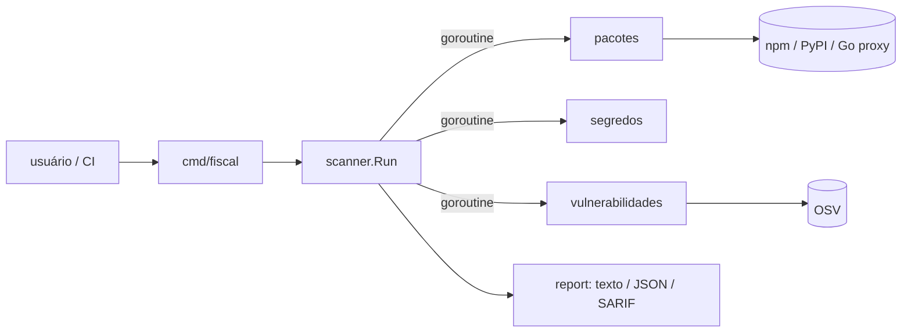
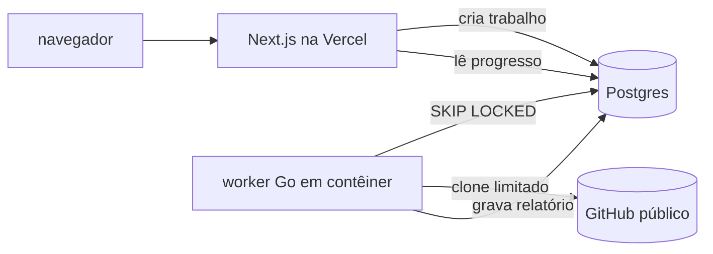

# Arquitetura

## Hoje (CLI)

- Cada verificador implementa `scanner.Checker` e roda na própria goroutine.
- Um verificador que falha não esconde os achados dos outros: o motor devolve resultado parcial mais o erro.
- Achados saem ordenados por gravidade, depois arquivo e linha.
- Regra fixa: nenhum verificador executa código do repositório analisado.
- O relatório em texto remove caracteres de controle vindos do repositório (nomes de arquivo podem carregar sequências de escape do terminal).

Verificadores ficam em pacotes próprios e entram na lista `checkers()` de `cmd/fiscal/main.go`.

### Verificador de pacotes (`packages/`)

Organizado por ecossistema, para que um novo (Cargo, Maven…) seja um arquivo novo mais um `case` em `parserFor`:

| Arquivo | Papel |
|---|---|
| `collect.go` | percorre o repositório, junta o que cada arquivo diz e resolve os imports |
| `npm.go`, `jsconfig.go` | `package.json`, `.npmrc`, `.yarnrc.yml`, imports JS/TS, aliases do `tsconfig` e do Deno |
| `python.go`, `pyproject.go`, `setup.go`, `python_names.go` | requirements, `pyproject.toml`, `Pipfile`, `setup.*`, conda, notebooks, imports Python e tabelas de nomes |
| `golang.go` | `go.mod`, `GONOPROXY`/`GOPRIVATE` |
| `registry.go`, `cache.go` | deps.dev e registros oficiais, retry, cache em disco |
| `checker.go` | consulta cada pacote uma vez e transforma as respostas em achados |

Fluxo:

1. `Collect` lê cada arquivo uma vez. Cada parser devolve o que o arquivo **declara**, o que o repositório **define**, escopos **privados**, **aliases** e **imports**.
2. Depois da varredura, descarta pacotes locais e privados, e transforma em consulta só os imports que nada no repositório explica.
3. `Checker` consulta cada pacote único uma vez (até 8 em paralelo). Se um registro fica indisponível depois das tentativas, as consultas restantes param e o erro sai uma vez só.
4. `judge` decide o achado: inexistente, recém-criado ou nada.

Regras detalhadas, privacidade e cache: [pacotes.md](pacotes.md).

## Planejado (web, semanas 6–8)

Propostas ainda abertas para decisão:

- **Fila no próprio Postgres** (`SELECT … FOR UPDATE SKIP LOCKED`) em vez de serviço de fila separado.
- **Segredos sempre mascarados** no relatório web; detalhe completo só para quem prova ser dono do repositório (login GitHub com permissão de push). Sem isso, a página pública vira coletor de chaves de terceiros.
- **Clone limitado** no worker: histórico parcial, `--filter=blob:limit`, sem submódulos nem LFS, com limite de tamanho, CPU, memória e tempo.
