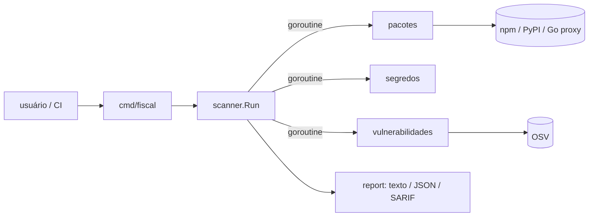
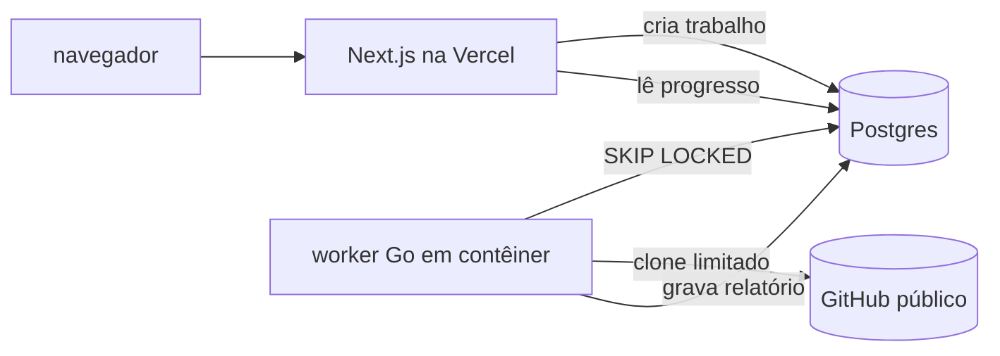

# Arquitetura

## Hoje (CLI)

- Cada verificador implementa `scanner.Checker` e roda na própria goroutine.
- Um verificador que falha não esconde os achados dos outros: o motor devolve resultado parcial mais o erro.
- Achados saem ordenados por gravidade, depois arquivo e linha.
- Regra fixa: nenhum verificador executa código do repositório analisado.
- O relatório em texto remove caracteres de controle vindos do repositório (nomes de arquivo podem carregar sequências de escape do terminal).

Verificadores (semanas 2–4) ficarão em pacotes próprios e entram na lista `checkers()` de `cmd/fiscal/main.go`.

## Planejado (web, semanas 6–8)

Propostas ainda abertas para decisão:

- **Fila no próprio Postgres** (`SELECT … FOR UPDATE SKIP LOCKED`) em vez de serviço de fila separado.
- **Segredos sempre mascarados** no relatório web; detalhe completo só para quem prova ser dono do repositório (login GitHub com permissão de push). Sem isso, a página pública vira coletor de chaves de terceiros.
- **Clone limitado** no worker: histórico parcial, `--filter=blob:limit`, sem submódulos nem LFS, com limite de tamanho, CPU, memória e tempo.
