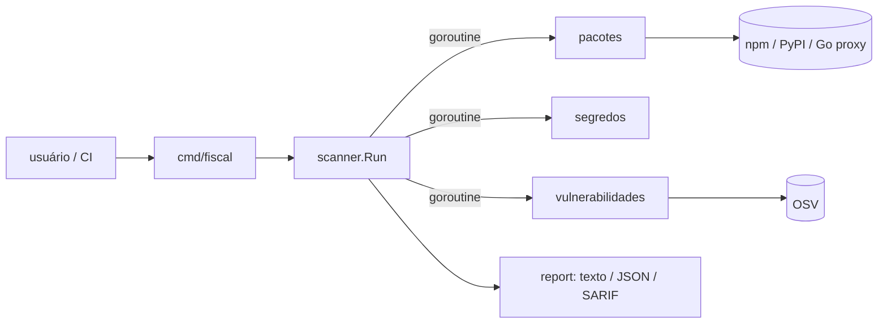
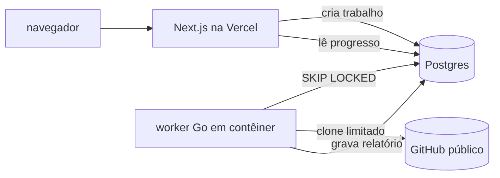

# Arquitetura

## Hoje (CLI)

- Cada verificador implementa `scanner.Checker` e roda na própria goroutine.
- Um verificador que falha não esconde os achados dos outros: o motor devolve resultado parcial mais o erro.
- Achados saem ordenados por gravidade, depois arquivo e linha.
- Regra fixa: nenhum verificador executa código do repositório analisado.
- O relatório em texto remove caracteres de controle vindos do repositório (nomes de arquivo podem carregar sequências de escape do terminal).

Verificadores ficam em pacotes próprios e entram na lista `checkers()` de `cmd/fiscal/main.go`.

### Verificador de pacotes (`packages/`)

1. `Collect` percorre o diretório (sem seguir symlinks, sem arquivos > 5 MB) e lê os manifestos. Antes de qualquer consulta, descarta pacotes definidos no próprio repositório e pacotes de registros privados (escopos do `.npmrc`/`.yarnrc.yml`, `GONOPROXY`/`GOPRIVATE`) — consultá-los seria alarme falso e vazaria nomes internos.
2. Cada pacote único é consultado uma vez, com no máximo 8 consultas simultâneas.
3. Fonte principal: `api.deps.dev/v3/systems/{npm|pypi|go}/packages/{nome}` — existência e data da primeira versão.
4. Se o deps.dev responde 404, confirma no registro oficial (`HEAD` no npm, `/simple/` do PyPI, `@latest` do proxy do Go). Existe lá mas não no deps.dev = publicado agora há pouco.
5. Erros de rede, 429 e 5xx: até 4 tentativas com backoff exponencial ou `Retry-After` (máx. 30 s).
6. Cache em disco: 24 h para pacotes encontrados, 1 h para não encontrados (um nome livre pode ser registrado por um atacante a qualquer momento).

## Planejado (web, semanas 6–8)

Propostas ainda abertas para decisão:

- **Fila no próprio Postgres** (`SELECT … FOR UPDATE SKIP LOCKED`) em vez de serviço de fila separado.
- **Segredos sempre mascarados** no relatório web; detalhe completo só para quem prova ser dono do repositório (login GitHub com permissão de push). Sem isso, a página pública vira coletor de chaves de terceiros.
- **Clone limitado** no worker: histórico parcial, `--filter=blob:limit`, sem submódulos nem LFS, com limite de tamanho, CPU, memória e tempo.
